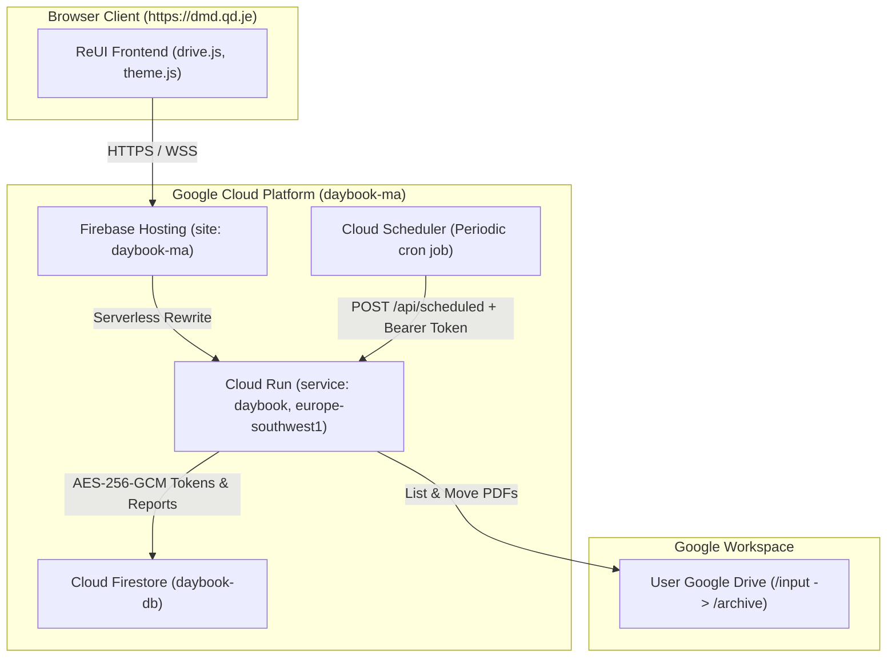

# Dental Monitoring Dashboard (Daybook)

[](https://nodejs.org/)
[](test/)
[](https://dmd.qd.je)
[]()

**Dental Monitoring Dashboard** (internal service: `daybook`) is a clinical productivity telemetry and reporting platform designed for dental monitoring specialists. It automates daily PDF report ingestion from Google Drive, calculates clinical scores and earnings benchmarks, tracks hourly velocity, manages daily notes, and exports executive vector PDF performance summaries.

---

## 🌐 Production & Canonical Domain

* **Primary Production URL**: [https://dmd.qd.je](https://dmd.qd.je)
* **Canonical Domain Policy**: All legacy domains (`*.web.app`, `*.firebaseapp.com`, `*.a.run.app`) automatically enforce an HTTP `301 Moved Permanently` redirect to `https://dmd.qd.je/`, preserving request paths and query parameters.
* **Domain Ownership**: Authenticated and verified with Google Search Console via DNS TXT verification.

---

## ⚡ Core Features

### 1. Automated PDF Ingestion & Atomic Archival
* **Drive Ingestion Pipeline**: Monitors a designated Google Drive input folder for daily exported PDFs.
* **Strict Validation**: Text-level PDF parser extracts operator metadata, report dates, shift counts, case distributions (2D vs. 3D), total points, and hourly case breakdowns. Ensures case totals match the sum of hourly items.
* **Atomic Move to `archive/`**: Moves processed PDFs into a child `archive` folder only *after* Firestore commits the parsed data.
* **Resilience**: Malformed or unrelated files stay untouched; transient move failures retry automatically without duplicate imports.

### 2. Clinical Telemetry, KPIs & Earnings Engine
* **KPI Metrics**: Total cases completed, distinct days worked, hourly case velocity, total points earned, and pace.
* **Earnings Calculations**: Transparent calculation of expected earnings:
  * **2D Validation Cases**: `1.65 MAD` per case
  * **3D Validation Cases**: `2.75 MAD` per case
* **Billing Cycles & Period Presets**:
  * Specialized **16th-to-15th** medical billing cycles (e.g., Nov 16 – Dec 15).
  * Quick presets: Today, Yesterday, Last 7 Days, Last 30 Days, Current Month, Last Month, or Custom Date Range.
  * Delta comparisons against preceding billing periods.

### 3. Interactive Hourly Performance & Milestone Insights
* **Interactive Hourly Chart**: SVG-rendered hourly case progression with interactive hover tooltips displaying cases, points, and pace.
* **Productivity Fun Facts**: Highlights peak volume days, lowest volume days, best velocity hours, and milestones (e.g. `350+` cases target completion).

### 4. Daily Notes ("Additional information about the day")
* **Contextual Documentation**: Attach shift reflections, equipment downtime logs, or clinical comments to specific report dates.
* **Interactive Calendar Picker**: Visual calendar modal showing available report dates and active note badges.
* **Chart Integration**: Dates with active notes surface a dedicated indicator chip in the hourly productivity breakdown and chart tooltips.

### 5. Conflict Resolution & Version Management
* Detects when multiple reports exist for the same date.
* Visual side-by-side diffing showing metrics, timestamps, and filenames.
* One-click conflict resolution to choose the active canonical version.

### 6. Native Vector PDF Export
* High-resolution, crisp vector PDF reports generated on-the-fly (`buildReportPdf`).
* Embeds summary KPIs, breakdown metrics, native vector bar charts, hourly trend lines, and notes.

### 7. 4-Theme Engine with Dynamic Dropdown Selector
* **ReUI Light**: Crisp, modern zinc light aesthetic (`#ffffff` / `#fafafa`).
* **ReUI Dark**: High-contrast zinc dark mode (`#09090b` body, `#121215` cards, `#27272a` borders).
* **Unslop Light**: Warm stone/paper craft palette (`#f7f4ee` background, `#1f1b16` text, quiet hairlines `rgba(31, 27, 22, 0.08)`, zero harsh glare).
* **Unslop Dark**: Warm dark graphite palette (`#161513` background, `#1c1a18` cards, `#262421` raised surfaces, `#efe9de` text, and inset top hairline highlights).
* **Smart System Defaults**: Automatically adapts to system appearance (`prefers-color-scheme`) when unconfigured, defaulting to ReUI Dark or ReUI Light.

### 8. Security & Google Verification Compliance
* **OAuth 2.0 with PKCE**: Secure Google authorization with CSRF token verification.
* **AES-256-GCM Encryption**: Refresh tokens are encrypted with authenticated encryption before persisting to Firestore.
* **Public App Showcase**: Complete app purpose, data privacy, and architecture are publicly visible at `https://dmd.qd.je/` prior to authentication.
* **Legal Compliance**: Direct, public links to [Privacy Policy](https://dmd.qd.je/privacy) and [Terms of Service](https://dmd.qd.je/terms).

---

## 🏗️ Architecture & Infrastructure



| Component | Service | Role |
| :--- | :--- | :--- |
| **Domain & Proxy** | Firebase Hosting (`daybook-ma`) | Edge CDN, SSL termination, rewrite to Cloud Run |
| **Backend Compute** | Google Cloud Run (`daybook`) | Node.js HTTP server, OAuth 2.0 PKCE, PDF text parser, API routes |
| **Database** | Cloud Firestore (`daybook-db`) | Encrypted user tokens, imported report models, daily notes, settings |
| **Periodic Scanner** | Cloud Scheduler | Automated cron trigger hitting `/api/scheduled` with bearer auth |
| **Storage** | Google Drive API | User-owned Drive folder: reads incoming reports, moves to `archive/` |

---

## 🚀 Local Development

The project includes an in-memory dev store (`MemoryDriveStore`) allowing full local frontend and API development **without cloud credentials**.

### Prerequisites
* **Node.js**: `>= 22.13.0`
* **npm**: `>= 10.0.0`

### Quick Start
1. Clone the repository:
   ```bash
   git clone https://github.com/sdebjit/dental-monitoring-dashboard.git
   cd dental-monitoring-dashboard
   ```
2. Install dependencies:
   ```bash
   npm install
   ```
3. Run the development server:
   ```bash
   npm start
   ```
4. Open [http://localhost:8080](http://localhost:8080) in your browser.
   * In local development, an account chooser allows instant login as `admin@example.com` or `clinician@example.com` with populated mock reports, conflict records, notes, and metrics.

---

## 🧪 Testing & Verification

The test suite runs with Node's native test runner without external dependencies:

```bash
# Run full unit and integration test suite (43 tests)
npm test

# Run JavaScript syntax verification across all modules
npm run check
```

---

## ⚙️ Environment Variables

| Variable | Required | Description |
| :--- | :---: | :--- |
| `DAYBOOK_BASE_URL` | Yes | Canonical origin without trailing slash (e.g. `https://dmd.qd.je` or `http://localhost:8080`) |
| `GOOGLE_CLIENT_ID` | Yes | Google OAuth 2.0 Web Client ID |
| `GOOGLE_CLIENT_SECRET` | Yes | Google OAuth 2.0 Web Client Secret |
| `DAYBOOK_ENCRYPTION_KEY` | Yes | 64-character hex string (32 bytes) for AES-256-GCM token encryption |
| `DAYBOOK_SCHEDULER_SECRET` | Yes | Bearer token secret required for `/api/scheduled` invocations |
| `FIRESTORE_DATABASE_ID` | Optional | Firestore database ID (defaults to `(default)`, production uses `daybook-db`) |
| `PORT` | Optional | HTTP port (Cloud Run injects `8080` by default) |

---

## 🚢 Production Deployment

Automated deployments are managed via **GitHub Actions** ([`.github/workflows/deploy.yml`](.github/workflows/deploy.yml)):

1. Push or merge changes to the `main` branch.
2. The workflow verifies syntax and executes tests (`npm test`).
3. Deploys container source to **Cloud Run** in `europe-southwest1`.
4. Deploys **Firebase Hosting** rewrites for site `daybook-ma`.

---

## 📄 License & Ownership

Private and proprietary. Developed for the Dental Monitoring Dashboard team.
