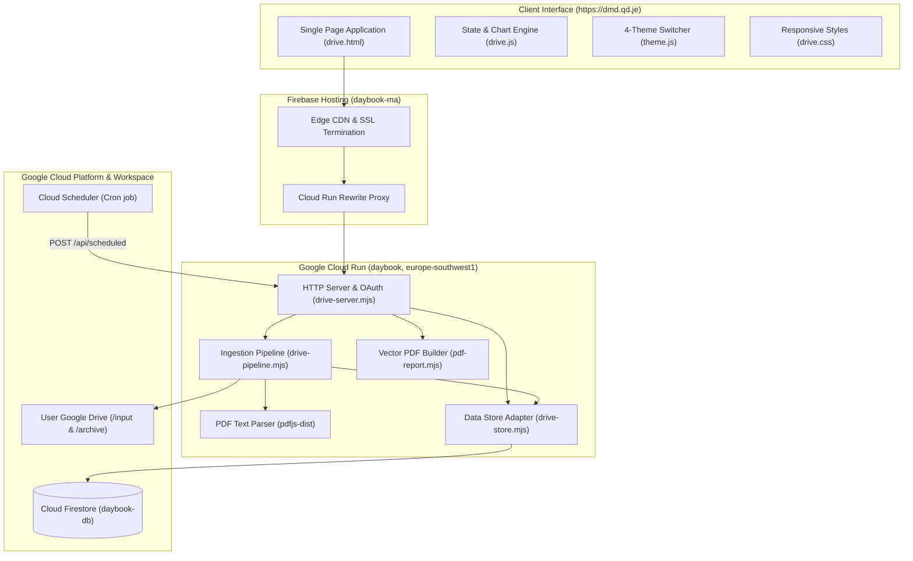
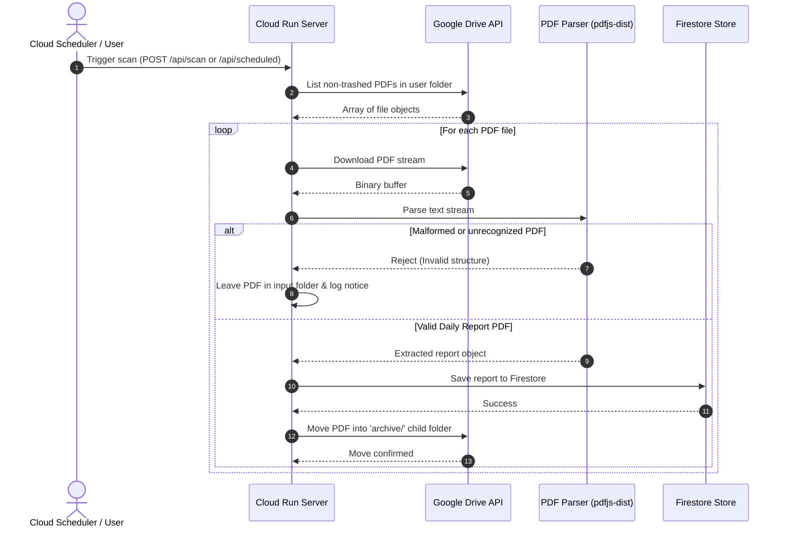

# Dental Monitoring Dashboard (Daybook) — Technical Documentation

This document serves as the comprehensive architectural and operational specification for the **Dental Monitoring Dashboard** web application.

---

## Table of Contents
1. [System Overview & Architecture](#1-system-overview--architecture)
2. [Codebase Structure & Module Responsibilities](#2-codebase-structure--module-responsibilities)
3. [Data Models & Persistence Schema](#3-data-models--persistence-schema)
4. [PDF Ingestion & Archival Pipeline](#4-pdf-ingestion--archival-pipeline)
5. [Clinical Telemetry, Earnings & Metrics Engine](#5-clinical-telemetry-earnings--metrics-engine)
6. [Daily Notes Module](#6-daily-notes-module)
7. [Conflict Detection & Resolution Engine](#7-conflict-detection--resolution-engine)
8. [Vector PDF Generator](#8-vector-pdf-generator)
9. [4-Theme Design Engine](#9-4-theme-design-engine)
10. [REST API Specification](#10-rest-api-specification)
11. [Security, Encryption & Google OAuth Verification](#11-security-encryption--google-oauth-verification)
12. [Local Development & Testing Workflows](#12-local-development--testing-workflows)
13. [Production Deployment & CI/CD](#13-production-deployment--cicd)

---

## 1. System Overview & Architecture

Dental Monitoring Dashboard is a multiuser productivity telemetry suite built for dental clinical monitoring teams. Operators export daily productivity report PDFs from their clinical monitoring console and drop them into a connected Google Drive folder. 

The dashboard:
* Scans the user's Drive folder periodically or on-demand.
* Parses and extracts structured case counts, points, 2D/3D case distributions, and hourly pacing data.
* Persists validated reports to Google Cloud Firestore.
* Moves ingested PDFs into an `archive` folder inside the user's Google Drive.
* Presents an interactive ReUI/Shadcn analytical dashboard featuring KPI cards, hourly velocity line charts, expected earnings, calendar-based daily notes, and vector PDF exports.



---

## 2. Codebase Structure & Module Responsibilities

```
dental-monitoring-dashboard/
├── .github/
│   └── workflows/
│       ├── ci.yml               # Automated test & syntax check on Pull Requests
│       └── deploy.yml           # Continuous deployment to Cloud Run & Firebase Hosting
├── docs/
│   └── DOCUMENTATION.md         # Comprehensive technical manual (this document)
├── public/
│   ├── drive.css                # Component styling, animations, and theme token palettes
│   ├── drive.html               # Main application shell, onboarding, and dashboard layout
│   ├── drive.js                 # Frontend application controller, charts, modal, and state
│   ├── favicon.svg              # Brand SVG favicon
│   ├── privacy.html             # Public privacy policy conforming to Google Verification
│   ├── settings.html            # Dedicated settings dashboard
│   ├── settings.js              # Settings controller (user profile, folder sync, delete data)
│   ├── terms.html               # Public terms of service
│   ├── terms.js                 # Terms controller with profile menu support
│   └── theme.js                 # 4-Theme Engine (ReUI Light/Dark, Unslop Light/Dark)
├── scripts/
│   └── check.mjs                # Syntax validation across all JavaScript modules
├── src/
│   ├── drive-api.mjs            # Google Drive API v3 client (folder & file operations)
│   ├── drive-pipeline.mjs       # Daily PDF ingestion, validation, and archival pipeline
│   ├── drive-server.mjs         # Core HTTP server, OAuth 2.0 PKCE, session management & APIs
│   ├── drive-store.mjs          # Firestore data access layer, AES encryption, MemoryDriveStore
│   └── pdf-report.mjs           # Native vector PDF generation with charts & KPI metrics
├── test/
│   ├── drive-pipeline.test.mjs  # Pipeline & parser unit tests
│   ├── drive-server.test.mjs    # API routing, session, redirect, and OAuth unit tests
│   ├── frontend-metrics.test.mjs# Pacing, earnings, fun facts, and billing cycle tests
│   ├── pdf-report.test.mjs      # Vector PDF generation and chart rendering tests
│   └── theme-engine.test.mjs    # 4-Theme resolution, migration, and dropdown tests
├── .env                         # Local development environment configuration
├── .firebaserc                  # Firebase project alias mapping (`daybook-ma`)
├── firebase.json                # Firebase Hosting configuration and Cloud Run rewrite rules
├── package.json                 # Project dependencies, scripts, and Node engine definition
└── README.md                    # Project landing documentation
```

---

## 3. Data Models & Persistence Schema

Data is stored in Google Cloud Firestore database `daybook-db`. All user-specific records are isolated under that user's Google subject identifier (`userId`).

### 3.1 User Configuration (`users/{userId}`)
```json
{
  "email": "clinician@example.com",
  "name": "Dr. Sarah Johnson",
  "folderId": "1a2B3c4D5e6F7g8H9i",
  "folderName": "Dental Daily Reports",
  "archiveFolderId": "9i8H7g6F5e4D3c2B1a",
  "archiveFolderName": "archive",
  "encryptedRefreshToken": "iv:authtag:ciphertext",
  "scanIntervalMinutes": 1440,
  "lastScannedAt": "2026-11-05T08:00:00.000Z",
  "onboarded": true,
  "createdAt": "2026-10-01T12:00:00.000Z"
}
```

### 3.2 Imported Report Document (`users/{userId}/reports/{reportDate}`)
```json
{
  "reportDate": "2026-10-27",
  "operator": "Sarah J.",
  "shift": "Morning",
  "cases": 243,
  "cases2D": 180,
  "cases3D": 63,
  "score": 2065.5,
  "benchmarkScore": 1950.0,
  "hourlyDetails": [
    { "hour": "08:00 - 09:00", "cases": 28, "points": 238.0 },
    { "hour": "09:00 - 10:00", "cases": 32, "points": 272.0 },
    { "hour": "10:00 - 11:00", "cases": 35, "points": 297.5 },
    { "hour": "11:00 - 12:00", "cases": 31, "points": 263.5 },
    { "hour": "12:00 - 13:00", "cases": 26, "points": 221.0 },
    { "hour": "13:00 - 14:00", "cases": 30, "points": 255.0 },
    { "hour": "14:00 - 15:00", "cases": 33, "points": 280.5 },
    { "hour": "15:00 - 16:00", "cases": 28, "points": 238.0 }
  ],
  "sourceFileId": "drive_file_id_123",
  "sourceFileName": "daily_report_2026-10-27.pdf",
  "importedAt": "2026-10-27T16:15:00.000Z"
}
```

### 3.3 Daily Notes Document (`users/{userId}/notes/{date}`)
```json
{
  "date": "2026-10-27",
  "text": "High volume 3D validation cases. Morning network downtime of 15 mins resolved.",
  "updatedAt": "2026-10-27T17:00:00.000Z"
}
```

---

## 4. PDF Ingestion & Archival Pipeline

The ingestion pipeline ([`src/drive-pipeline.mjs`](file:///Users/sadhukhandebjit/Codes/dental-monitoring-dashboard/src/drive-pipeline.mjs)) executes in a safe, multi-step transaction pattern:



### Validation Invariants:
1. **Total Cases Check**: The sum of all hourly row cases must strictly equal the reported aggregate completed cases.
2. **Commit Before Move**: The PDF file is **never moved** to `archive/` until Firestore has successfully persisted the parsed report document. If the move fails due to a network glitch, subsequent scans detect the existing report and complete the move without re-importing.
3. **Foreign PDF Isolation**: Other PDFs in the user's folder (e.g. guidelines, invoices) are ignored silently without disrupting the pipeline.

---

## 5. Clinical Telemetry, Earnings & Metrics Engine

The metrics calculation engine ([`public/drive.js`](file:///Users/sadhukhandebjit/Codes/dental-monitoring-dashboard/public/drive.js)) aggregates performance data across chosen date intervals:

### 5.1 Case Classification & Expected Earnings
Clinical compensation is calculated automatically based on case complexity breakdown:
* **2D Validation Cases**: Compensated at **`1.65 MAD`** (Moroccan Dirham) per case.
* **3D Validation Cases**: Compensated at **`2.75 MAD`** per case.
* **Expected Total Earnings Formula**:
  $$\text{Earnings (MAD)} = (\text{Cases}_{\text{2D}} \times 1.65) + (\text{Cases}_{\text{3D}} \times 2.75)$$

### 5.2 Billing Cycle & Presets
* **Medical Billing Cycle**: Defined from the **16th of month $M$ through the 15th of month $M+1$**.
  * If selected date $\ge 16$, cycle runs from `YYYY-MM-16` to `YYYY-(MM+1)-15`.
  * If selected date $< 16$, cycle runs from `YYYY-(MM-1)-16` to `YYYY-MM-15`.
* **Standard Presets**: Today, Yesterday, Last 7 Days, Last 30 Days, Current Month, Last Month, Custom Range.

### 5.3 Velocity & Productivity Fun Facts
* **Hourly Velocity**: Average cases processed per logged working hour:
  $$\text{Hourly Pace} = \frac{\sum \text{Cases}}{\sum \text{Logged Hours}}$$
* **Milestone Detection**: Identifies days exceeding `350` completed cases, flagging them as high-volume achievements.

---

## 6. Daily Notes Module

*Terminology Rule: Always referred to as "Notes" or "Additional information about the day".*

1. **Storage**: Notes are stored in `users/{userId}/notes/{date}`.
2. **Interactive Calendar Picker**:
   * Opens an interactive monthly calendar modal.
   * Days with imported daily reports are marked **active and selectable**.
   * Days with existing notes display a distinctive amber badge.
   * Selecting a day loads the existing note for editing or allows creating a new one.
3. **Chart Tooltip Annotations**:
   * Hovering over the hourly productivity chart shows a visual note indicator if notes exist for that day.
   * The active note is rendered directly in the dashboard overview alongside daily summary metrics.

---

## 7. Conflict Detection & Resolution Engine

When multiple reports are uploaded for the same date (e.g., partial morning export followed by full end-of-day export):
1. **Detection**: `detectDuplicateReports()` scans imported records and identifies duplicates by matching dates.
2. **Conflict Warning**: A prominent conflict notification banner appears in the dashboard.
3. **Resolution Modal**:
   * Displays side-by-side comparison cards with file names, import timestamps, case counts, and scores.
   * Operator selects the correct version (e.g., Version B).
   * Backend endpoint `POST /api/reports/resolve-conflict` sets the chosen version as active and archives the alternate.

---

## 8. Vector PDF Generator

Implemented in [`src/pdf-report.mjs`](file:///Users/sadhukhandebjit/Codes/dental-monitoring-dashboard/src/pdf-report.mjs) using native vector PDF stream generation:
* **No Headless Browsers**: Generates vector PDFs without Puppeteer or Chromium, executing in sub-50ms with minimal memory footprint.
* **Vector Visuals**: Renders vector-sharp bar charts, sparklines, trend curves, typography, and badges.
* **Print-Ready Layout**: Formatted cleanly on standard A4 layout with page headers, operator credentials, KPI summary grid, hourly breakdown table, and attached notes.

---

## 9. 4-Theme Design Engine

Managed in [`public/theme.js`](file:///Users/sadhukhandebjit/Codes/dental-monitoring-dashboard/public/theme.js) and [`public/drive.css`](file:///Users/sadhukhandebjit/Codes/dental-monitoring-dashboard/public/drive.css):

| Theme Key | Name | Visual Language | Color Ramp |
| :--- | :--- | :--- | :--- |
| `reui-light` | **ReUI Light** | Modern crisp zinc light | `#ffffff` background, `#fafafa` muted, `#e4e4e7` borders |
| `reui-dark` | **ReUI Dark** | High-contrast dark zinc | `#09090b` body, `#121215` cards, `#27272a` borders |
| `unslop-light` | **Unslop Light** | Warm stone & paper craft | `#f7f4ee` background, `#ffffff` cards, `#1f1b16` text, quiet `0.08` hairlines |
| `unslop-dark` | **Unslop Dark** | Warm graphite night shift | `#161513` background, `#1c1a18` cards, `#262421` raised, `#efe9de` text |

### Dynamic Behavior:
* **Dropdown Selection**: Switched via `<select class="theme-select-dropdown">` located in the profile popover.
* **System Appearance Integration**: When no theme is explicitly saved, automatically resolves to **ReUI Dark** (if `prefers-color-scheme: dark`) or **ReUI Light** (if light).
* **Attribute Selectors**: Core dark styling utilizes `[data-theme*="dark"]`, enabling shared dark styles across both `reui-dark` and `unslop-dark` with theme-specific token overrides.

---

## 10. REST API Specification

All endpoints require authentication via session cookie (`__session`), except where noted.

### 10.1 Authentication & Profile
| Endpoint | Method | Auth | Description |
| :--- | :---: | :---: | :--- |
| `/auth/login` | GET | Public | Initiates Google OAuth 2.0 PKCE flow |
| `/auth/callback` | GET | Public | Exchanges authorization code, sets secure session cookie |
| `/auth/logout` | POST | User | Clears user session cookie |
| `/api/me` | GET | User | Returns active session user profile and sync status |
| `/api/profile` | POST | User | Updates user display name (`{ name: string }`) |
| `/api/onboarded` | POST | User | Marks onboarding complete and sets custom folder |

### 10.2 Reports & Sync
| Endpoint | Method | Auth | Description |
| :--- | :---: | :---: | :--- |
| `/api/reports` | GET | User | Returns array of imported reports for the user |
| `/api/scan` | POST | User | Triggers an immediate Google Drive folder scan |
| `/api/scheduled` | POST | Bearer | Scheduled cron trigger across all due users |
| `/api/import-stats`| GET | User | Returns aggregate count and 5 most recent imports |
| `/api/source-status`| GET | User | Validates Google Drive folder access and permissions |
| `/api/reports/resolve-conflict` | POST | User | Resolves duplicate report conflict for a date |
| `/api/export-pdf` | POST | User | Generates and streams native vector PDF report |

### 10.3 Daily Notes
| Endpoint | Method | Auth | Description |
| :--- | :---: | :---: | :--- |
| `/api/notes` | GET | User | Returns all notes mapped by date: `{ [date]: string }` |
| `/api/notes` | POST | User | Saves note for date: `{ date: "YYYY-MM-DD", text: string }` |
| `/api/notes?date=...` | DELETE | User | Deletes note for specified date |

### 10.4 Data Management & Privacy
| Endpoint | Method | Auth | Description |
| :--- | :---: | :---: | :--- |
| `/api/stop-sync` | POST | User | Disconnects Drive integration and deletes tokens |
| `/api/delete-all-data` | POST | User | Permanently purges all user reports, notes, and profile |

---

## 11. Security, Encryption & Google OAuth Verification

### 11.1 Token Encryption (AES-256-GCM)
User refresh tokens are never stored as plaintext. Before writing to Firestore, tokens are encrypted using **AES-256-GCM**:
$$\text{Ciphertext} = \text{AES-256-GCM}(\text{PlaintextToken}, K_{\text{32}}, \text{IV}_{\text{12}})$$
The output string format is: `iv_hex:auth_tag_hex:ciphertext_hex`.

### 11.2 Scope Minimization
The app strictly requests only the scopes necessary for operation:
* `openid`: User authentication
* `email`: Account identification
* `profile`: Operator display name and avatar
* `https://www.googleapis.com/auth/drive`: Ingesting PDFs and moving to `archive/`

### 11.3 Google Verification Compliance
* **Custom Verified Domain**: Application runs on `https://dmd.qd.je/` (verified via Google Search Console).
* **Public Showcase**: The homepage provides a complete, publicly accessible feature overview and data security explanation without requiring authentication.
* **Permanent Redirects**: Legacy shared domains (`*.web.app`, `*.firebaseapp.com`) 301-redirect to `https://dmd.qd.je/`.
* **Legal Disclosures**: Fully accessible [Privacy Policy](https://dmd.qd.je/privacy) and [Terms of Service](https://dmd.qd.je/terms).

---

## 12. Local Development & Testing Workflows

The server automatically detects when running without Google Cloud credentials and initializes an in-memory test store (`MemoryDriveStore`).

```bash
# Start local server with zero cloud setup
npm start
```
* **Local URL**: [http://localhost:8080](http://localhost:8080)
* **Mock Account Chooser**: Sign in instantly as `admin@example.com` or `clinician@example.com`.

### Automated Testing
```bash
# Execute test suite (43 tests across pipeline, server, metrics, pdf, and themes)
npm test

# Syntax verification across 15 JavaScript modules
npm run check
```

---

## 13. Production Deployment & CI/CD

Continuous deployment is managed via GitHub Actions:

### Pipeline Stages ([`.github/workflows/deploy.yml`](.github/workflows/deploy.yml)):
1. **Test Job**: Runs `npm ci`, `npm run check`, and `npm test` on Node.js 24 (`ubuntu-latest`).
2. **Deploy Job**:
   * Authenticates with Google Cloud via `google-github-actions/auth@v3`.
   * Deploys containerized application to **Google Cloud Run**:
     ```bash
     gcloud run deploy daybook \
       --source . \
       --region europe-southwest1 \
       --service-account daybook-run@daybook-ma.iam.gserviceaccount.com \
       --allow-unauthenticated \
       --set-env-vars "DAYBOOK_BASE_URL=https://dmd.qd.je,FIRESTORE_DATABASE_ID=daybook-db,..."
     ```
   * Deploys **Firebase Hosting** rewrites targeting site `daybook-ma`:
     ```bash
     npx firebase-tools@latest deploy --only hosting --project daybook-ma
     ```
